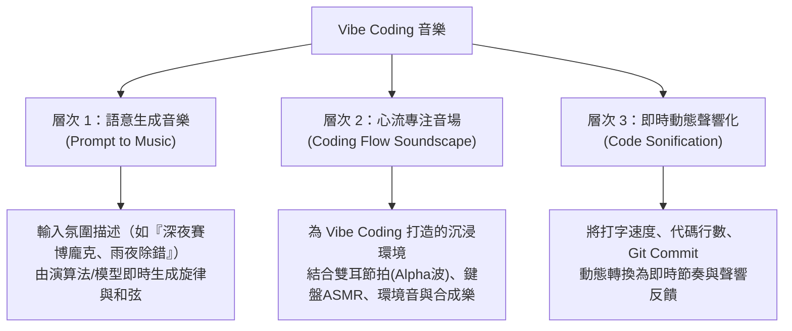

# 🎵 Vibe Coding 音樂：可行性分析與系統規劃書

> **專案目標**：探索並實作「Vibe Coding」與「音樂創作 / 專注心流音場」的結合可能性，打造專屬工程師與創作者的氛圍音樂實驗系統。

---

## 🧭 一、什麼是「Vibe Coding 音樂」？

「Vibe Coding」是由 Andre Karpathy 所推廣的全新開發哲學——**開發者不再拘泥於底層語法細節，而是以直覺、意圖（Intent）與氛圍（Vibe）為導向，透過自然語言與 AI 協同完成複雜系統**。

將這個概念延伸至「音樂」，可劃分為三個層次的理解與應用：

---

## 💡 二、可行性分析：這真的可能嗎？

**答案是：不僅完全可行，而且在當前的 Web 音訊與 AI 技術下，能夠做到令人驚艷的成品！**

以下從三種技術路徑進行可行性與成本效益評估：

| 技術路徑 | 核心技術棧 | 運行環境 | 成本與延遲 | 適用場景與特色 | 可行性評分 |
| :--- | :--- | :--- | :--- | :--- | :--- |
| **路徑 A：前端演算法與合成器 (推薦首選)** | Web Audio API、`Tone.js`、五聲音階/多利安調式規則引擎 | 純瀏覽器端 (Client-side) | **零成本**、零延遲、無需 API Key | 利用音樂理論與隨機生成演算法，即時合成無限循環的 Lo-Fi、Ambient、Synthwave 背景樂，永不重複且極度穩定。 | ⭐⭐⭐⭐⭐ (極力推薦) |
| **路徑 B：LLM 轉譯樂理結構 (Prompt-to-Code-to-Audio)** | Gemini / Claude + `Tone.js` / ABC Notation / MIDI | 瀏覽器 + LLM API | 極低 API 成本、秒級響應 | 使用者輸入「給我一段憂鬱而專注的下雨夜琶音」，LLM 將其轉為精準的樂譜 JSON 或 Tone.js 音軌指令並於前端即時演奏。 | ⭐⭐⭐⭐⭐ (最具 Vibe Coding 靈魂) |
| **路徑 C：重量級端對端 AI 音樂模型 (Text-to-Audio)** | Suno API、Udio、MusicGen (Audiocraft) | 雲端伺服器 / 高階 GPU | 延遲較高 (10~30秒)、API 有付費門檻 | 產生高音質、完整編曲的成品歌曲，但互動性與即時調節彈性較低。 | ⭐⭐⭐☆ (適合生成完畢後回放) |

---

## 🛠️ 三、推薦 MVP 落地架構：「Vibe Coder - 音樂心流工作站」

建議於本資料夾（`vibe coding音樂`）中打造一個**純前端、高顏值、高互動性的 Web 音樂實驗系統**：

### 1. 核心功能模組

1. **🎭 氛圍選擇與生成器（Vibe Mood Selector）**：
   - 內建數種專注氛圍情境預設（Presets）：
     - ☕ **Lo-Fi Coffee Shop**：溫暖的電子鋼琴（Rhodes）、輕柔鼓點、黑膠唱片雜訊（Vinyl Crackle）。
     - 🌆 **Cyberpunk Midnight**：延綿沉穩的合成器貝斯（Synthwave Bassline）、八零年代琶音、遠方雷雨聲。
     - 🧘 **Deep Work Zen**：432Hz 環境空靈無拍無形音（Ambient Drone）、頌缽聲、Alpha 腦波。
   - **自然語言微調**：輸入簡單關鍵字（例如「更慢一點」、「加重雨聲」、「多點太空感」），系統自動動態調整 BPM、濾波頻率（Lowpass Filter）與混響程度。

2. **🎛️ 即時混音與心流控制台（Flow Mixer Console）**：
   - **音量分軌控制**：旋律軌（Melody）、和弦軌（Chords）、打擊節奏軌（Beats）、環境白噪音軌（Ambience）。
   - **工程師心流輔助音效（ASMR Layer）**：
     - 機械鍵盤敲擊聲（青軸 / 茶軸）
     - 窗外雨聲與壁爐柴火聲
     - 專注雙耳節拍（Binaural Beats：40Hz Gamma / 10Hz Alpha）

3. **✨ 視覺化動態反饋（Audio Visualizer）**：
   - 結合 HTML5 Canvas 與 Web Audio AnalyserNode，展現炫目而優雅的音訊頻譜波形、粒子特效或霓虹光暈，營造頂級 Coding 氛圍感。

---

## 🚀 四、實作階段計畫 (Roadmap)

- [ ] **階段一：基礎音訊引擎搭建**
  - 建立 HTML5 / CSS / Vanilla JS 骨架。
  - 引入 `Tone.js` 庫，封裝核心合成器（PolySynth、NoiseSynth、FeedbackDelay、Reverb）。
- [ ] **階段二：演算法生成與和弦進行（Chord Progression Engine）**
  - 設計「永遠和諧」的調式音階（如 Pentatonic、Dorian）。
  - 實現隨機琶音與低保真（Lo-Fi）鼓點生成迴圈。
- [ ] **階段三：環境音與 ASMR 混音模組**
  - 加入雨聲合成器、雙耳節拍發生器、黑膠雜音生成器。
- [ ] **階段四：現代化質感介面與視覺化（UI & Canvas Visualizer）**
  - 打造深色 Glassmorphism 風格的高質感控制介面。
  - 串接音訊頻譜分析器，繪製動態流體波形。
- [ ] **階段五（進階擴充）：AI 自然語言 Prompt 聯動**
  - 串接 Gemini API，輸入日常話語自動轉換為專屬的音樂參數與樂句。

---

> 📌 **結語**：Vibe Coding 音樂不僅完全可行，而且是「技術 + 藝術 + 心流體驗」的完美交集！
